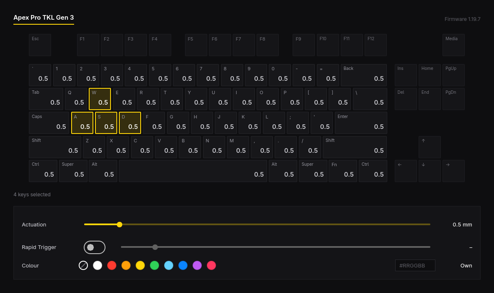

# Omni

Tune analog keyboards on Omarchy: set each key's actuation point, Rapid Trigger and colour from one quiet window,
without the vendor's Windows software.



## Keyboards

| Keyboard | Actuation | Rapid Trigger | Colour | Saved on the keyboard |
|---|---|---|---|---|
| SteelSeries Apex Pro TKL Gen 3 (wired, `1038:1642`) | per key, the 20 depths its own menu offers (0.1–4.0 mm) | on/off and sensitivity per key | per key, live | actuation and Rapid Trigger: see below |
| Wooting 60HE v2 (`31e3:1340`–`1342`) | 0.1–4.0 mm per key, 0.05 mm steps | on/off, press and release per key | per key, live | yes, into the active profile slot |

Colours are kept in `~/.config/omni/` and sent again whenever the keyboard is plugged in, because neither keyboard
stores per-key colours from the host. Choosing the crossed-out swatch hands lighting back to the keyboard's own effects.

Each driver talks to the keyboard's configuration interface directly over hidraw and only sends commands from a fixed
allowlist; firmware update, factory reset, profile erase and flash-layout commands are refused in code. The protocol
notes, with their sources, are in [`docs/`](docs/).

## Lighting and the screen

The **Lighting** tab draws effects on the computer and streams them to the keyboard: static per-key colours,
breathing, spectrum, wave, aurora, starlight and rain, with glow, ripple or heatmap reactions to key presses, in your
Omarchy theme's colours, a rainbow or your own. The **Screen** tab puts a GIF or picture on the Apex's OLED, dithered
to its 128 × 40 pixels, from a file or from a GIPHY search.

Both are drawn by `omni lighting`, a systemd user service (`omni-lighting.service`) that Omni starts the first time
you use them, so they keep running after the window closes. It reads each keyboard's settings from
`~/.config/omni/<keyboard>.json`, reads key presses from the keyboard only while a reaction is on (in memory, never
stored), and hands lighting and the screen back to the keyboard when it stops:
`systemctl --user disable --now omni-lighting`.

GIF search needs your own free [GIPHY API key](https://developers.giphy.com/dashboard/) (100 searches an hour). It is
kept in `~/.config/omni/giphy.key`, readable only by you; only your searches go to GIPHY, when you press Enter.

## Use

| Key | Does |
|---|---|
| Click | Select a key |
| Shift+Click | Add or remove a key |
| Drag | Select every key in the box |
| Ctrl+A | Select all keys |
| Esc | Clear the selection |
| ↑ / ↓ | Actuation shallower or deeper |
| Space | Rapid Trigger on or off |
| [ / ] | Rapid Trigger sensitivity |
| 1 / 2 / 3 | Keys, Lighting, Screen |
| Tab | Next keyboard |
| Ctrl+Z / Ctrl+Shift+Z | Undo / redo |
| ? | Show every shortcut |
| Q | Quit |

Changes reach the keyboard as you make them. On the Wooting they are saved to the active profile once you stop
editing for a moment, and when Omni quits.

## Build

```sh
bin/build      # build/omni
bin/test       # unit tests, offscreen
bin/install    # makepkg -fsi: binary, launcher entry, icon, udev rule
```

The udev rule gives the logged-in user access to the keyboards' hidraw nodes. After the first install, replug the
keyboard (or run `sudo udevadm trigger`) so it applies.

## Adding a keyboard

Write a `Keyboard` subclass (`src/keyboard.h`): it names its keys with browser key codes (`KeyA`, `ShiftLeft`,
`IntlBackslash`), reads and writes `KeySettings` in millimetres, and lists the device in `drivers()`
(`src/keyboard.cpp`). The window, undo, selection and colour storage come for free.

## License

MIT. Theme and translator code follows Omacut and Monologue by David Heinemeier Hansson.
